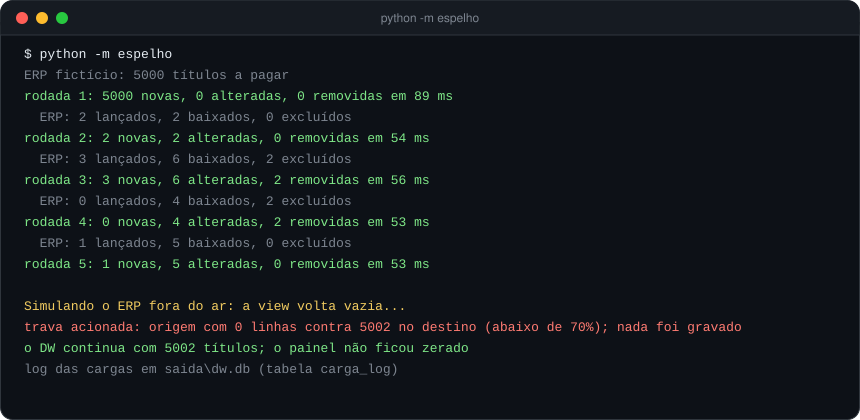
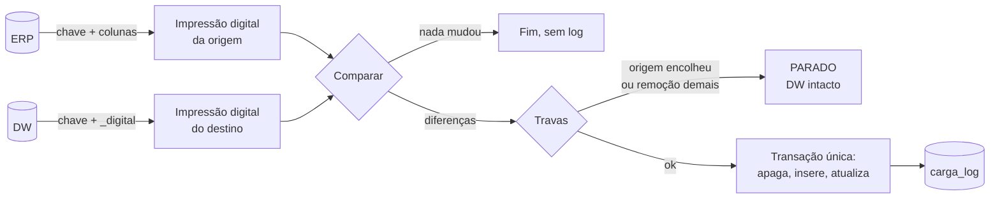

<h1 align="center">DW em tempo real</h1>

<p align="center">
  <b>Espelho incremental ERP → Data Warehouse, de minuto em minuto, com impressão digital por linha e travas de segurança.</b>
</p>

<p align="center">
  
  
  
  
</p>

---

## O problema

A carga noturna (ou de hora em hora) deixa o financeiro olhando para um número velho. Recarregar tudo a cada
minuto pesa no ERP e, pior, abre uma janela em que a tabela do DW fica vazia ou pela metade enquanto alguém
atualiza o Excel ou o painel.

## A solução

Em vez de recarregar, o espelho **compara impressões digitais** das linhas de origem e destino e grava **só a
diferença**, numa única transação. Quando nada mudou, a rodada termina sem tocar no DW e sem poluir o log.

<p align="center"></p>



## Travas de segurança

| Situação | O que o espelho faz |
|---|---|
| ERP fora do ar, view devolvendo vazio ou filtro errado | a origem caiu abaixo de **70%** do destino: para **sem gravar** e registra `PARADO` |
| Uma rodada querendo apagar mais de **30%** do DW | para sem gravar |
| Erro no meio da gravação | a transação desfaz tudo; o painel nunca lê o espelho pela metade |
| Rodada sem mudanças | não grava nada, nem log |

## Rodando a demonstração

```bash
git clone https://github.com/EdyRocha2005/dw-tempo-real.git
cd dw-tempo-real
python -m espelho            # ERP fictício com 5.000 títulos, 6 rodadas e a trava no final
python -m pip install pytest
python -m pytest -q          # 9 testes
```

Só biblioteca padrão: a demonstração usa SQLite nos dois lados. Os fornecedores e títulos são gerados na hora e
não existem.

## Na produção

A versão que roda de verdade segue a mesma ideia, ajustada para SQL Server e para um ERP com milhões de linhas:

- **impressão digital calculada no banco**, lendo só índices (chave + colunas que mudam), em cerca de 1 segundo;
- **marca d'água** pela data de alteração do ERP, com uma margem de 2 minutos para não perder transações longas;
- **recarga completa de madrugada** e sempre que o saldo de abertura muda, protegida pelas mesmas travas;
- **Agendador de Tarefas do Windows** a cada minuto, rodando oculto, com log só quando algo mudou;
- objetos no DW com o **mesmo nome das views do ERP**, para quem já tem consultas e planilhas prontas.

## Estrutura

```
espelho/
  digital.py     funções puras: impressão digital, comparação, travas (testadas sem banco)
  motor.py       uma rodada: lê, compara, grava a diferença numa transação, registra o log
  __main__.py    demonstração no terminal
demo/
  erp_ficticio.py  ERP de mentira e o simulador de lançamentos, baixas e exclusões
tests/
  test_espelho.py  inclusive "o espelho fica igual ao ERP rodada após rodada"
```

---

<p align="center"><sub>Feito por <a href="https://github.com/EdyRocha2005">Rocha</a> · dados fictícios · licença MIT</sub></p>
